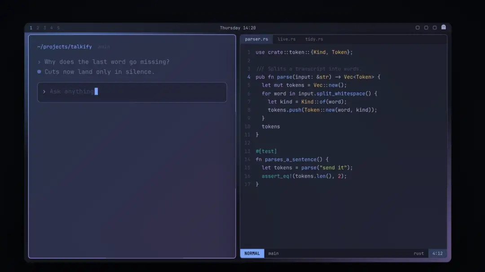
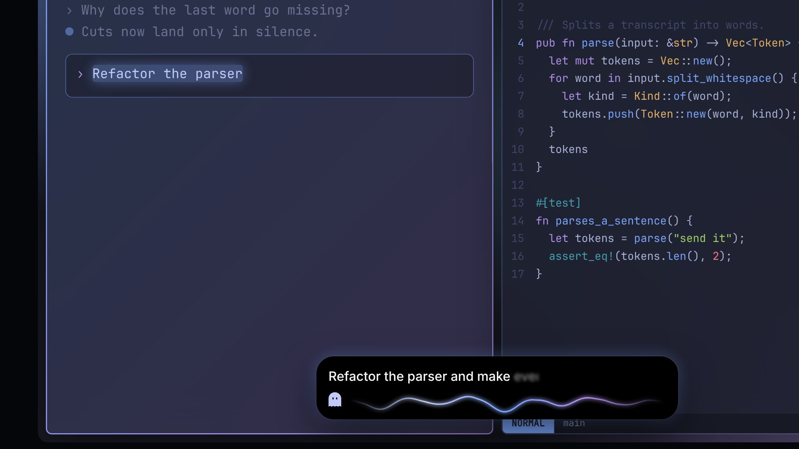
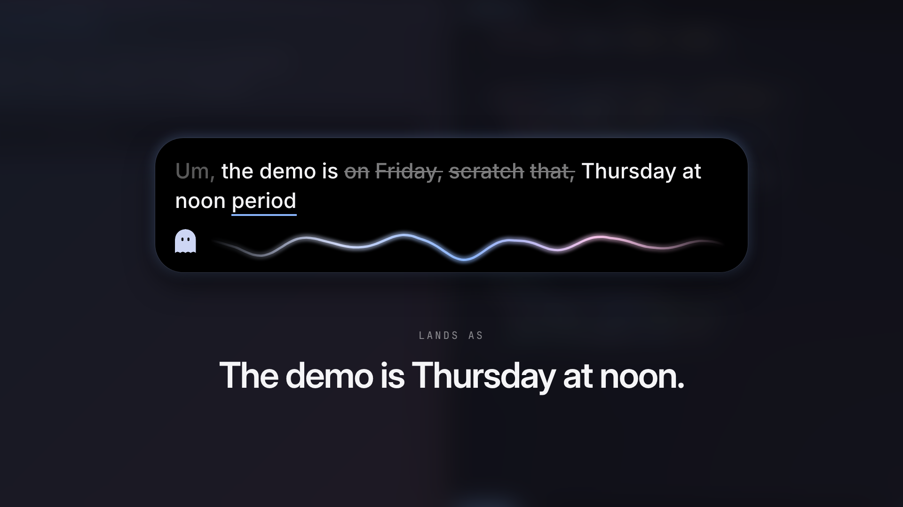
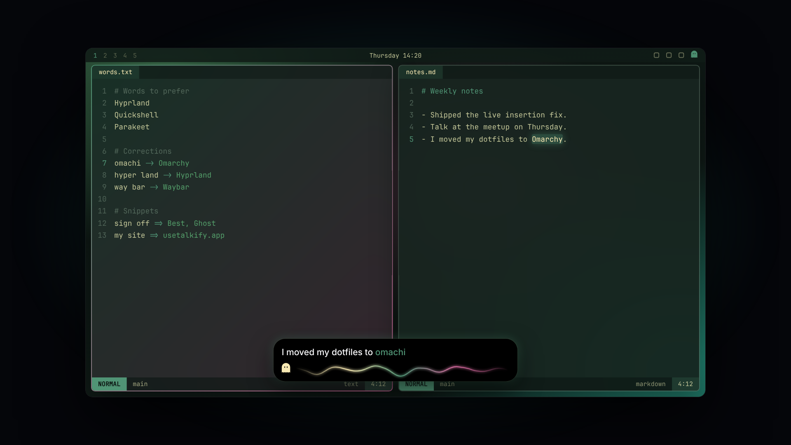
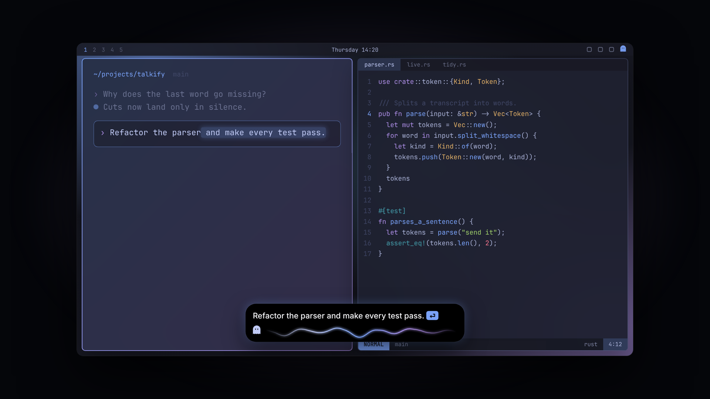
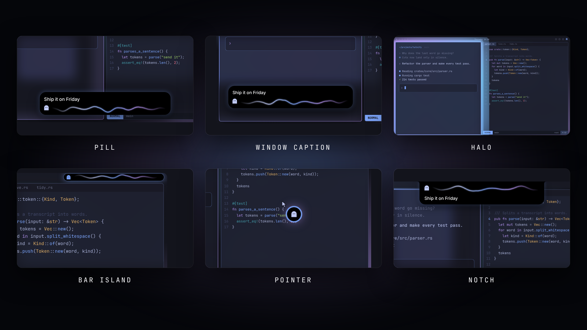
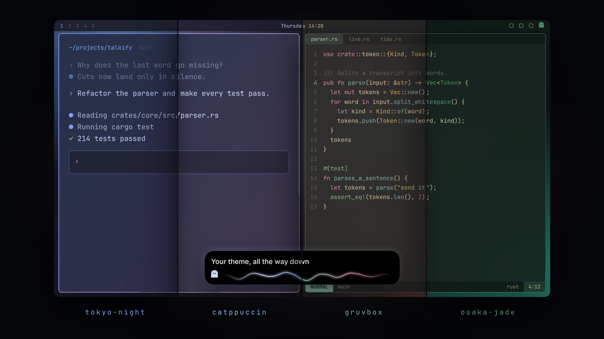
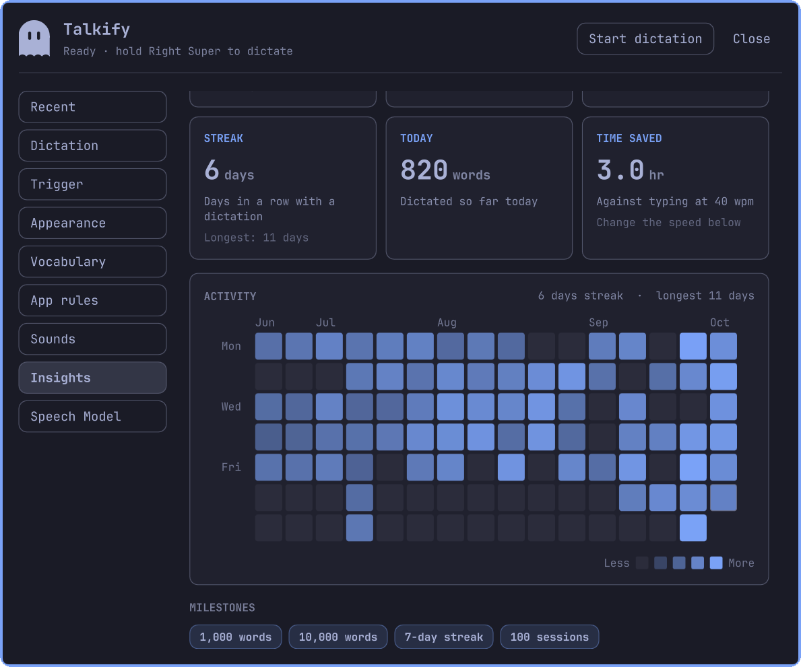
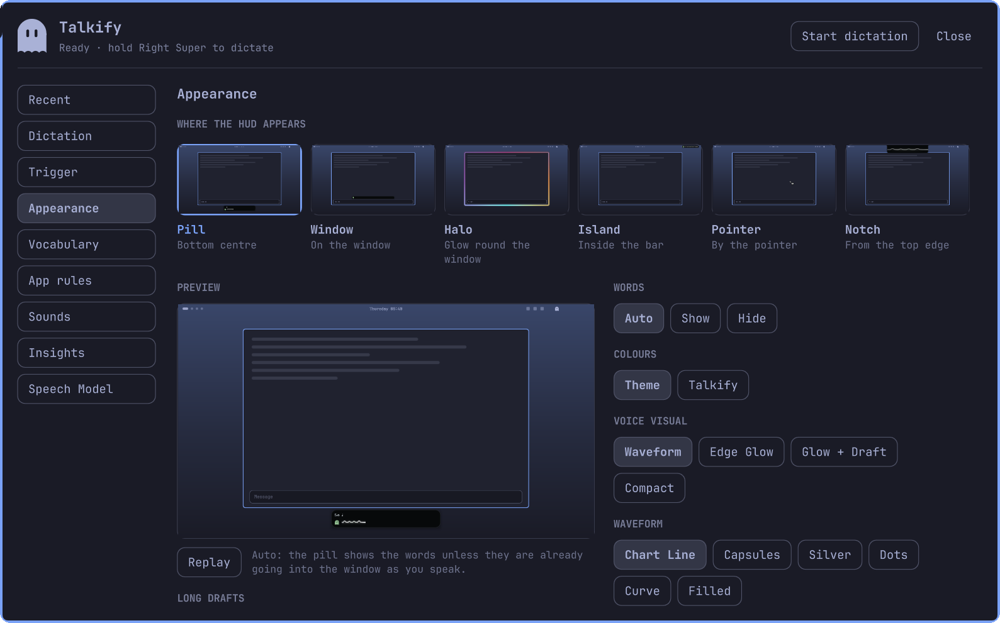

<h1 align="center">Talkify for Omarchy</h1>

<h3 align="center">Fast, beautiful and private voice dictation</h3>

<p align="center">
  
</p>

<p align="center">
  <a href="https://github.com/InsaneArts/talkify-omarchy/raw/main/.github/assets/talkify-omarchy.mp4"><b>Download the 30-second film</b></a> (MP4, 4 MB)
</p>

Talkify is dictation for [Omarchy](https://omarchy.org). Hold Right Super, say what you want to write, let go, and the words are pasted into the window you were typing in: a terminal, a browser, an editor, a chat. Speech recognition runs on your machine with NVIDIA's Parakeet model. There is no cloud, no account, and nothing you say leaves the computer.

It is the Linux sibling of [Talkify for macOS](https://github.com/tornikegomareli/Talkify) ([usetalkify.app](https://usetalkify.app)), rebuilt for Hyprland and the Omarchy bar with the same HUD, the same ghost and the same rules.

## Hold, speak, let go

Hold Right Super and talk; let go and the text goes in. Tap the key instead to keep listening hands-free, and tap again to finish. Escape cancels.

Your shortcuts keep working. Super+C, Super+Return and every other chord that starts with Right Super still do what they did: Talkify tells a shortcut from dictation by what you press next. The microphone opens the moment the key goes down, so the first word is never lost. A mouse side button can be the trigger too.

The text is pasted into the window the session started in. Your clipboard is put back afterwards and kept out of the clipboard history. If you switched windows while talking, the text waits on the clipboard instead of landing in the wrong place. Music and videos that are playing pause while you talk and resume after.

On an Intel Core i5-13600KF, an 11-second sentence is transcribed in about 0.3 seconds, on the CPU alone. Parakeet understands 25 European languages and detects which one you speak.

## Words land while you speak

In a hands-free session, Talkify can paste a phrase at a time as you pause, so a long dictation is already in the window by the time you finish. It only cuts where you stopped speaking, so no word is ever split between two pastes.

<p align="center">
  
</p>

## It writes what you meant

The Tidy pass cleans up what the Speech Model heard, and never writes a word you did not say:

- "um", "uh" and stutters go;
- "comma", "period", "question mark" and "new line" become the marks, when you pause around them;
- "scratch that" removes the phrase before it.

The HUD shows all of it before the text lands. Fillers fade, a scratched phrase is struck through, and spoken punctuation is underlined until it turns into the mark.

<p align="center">
  
</p>

## It learns your words

`~/.config/talkify/words.txt` holds the words Talkify should spell your way, one per line, in three forms:

```text
Hyprland                    a word to prefer
omachi -> Omarchy           a correction
sign off => Best, Ghost     a snippet: say the left, get the right
```

Words are matched by how they sound as well as how they are spelled, so a name the model has never heard still comes out right. When it gets a word wrong, fix it in place, select your correction and run `talkify teach`: Talkify finds what it heard and learns the pair. The ghost in the bar nods when it does.

<p align="center">
  
</p>

## Talk to your terminal

App rules change what happens per app, by window class. Every terminal starts with a rule of its own: the closing period is dropped, and "send it" said last presses Enter. "Run the tests and fix what fails, send it" goes straight to your coding agent.

<p align="center">
  
</p>

A rule can turn the Tidy pass off, drop the closing period, write in lower case, add a trailing space, and press Enter never, on "send it", or always. Rules are set in Settings → App rules, which lists the apps you dictated into recently.

## A HUD where you want it

The HUD shows that Talkify is listening, what it heard, and what it is about to do. Put it in one of six places:

- **Pill**: a small capsule at the bottom centre, the one most dictation apps settled on;
- **Window caption**: pinned to the window the text is going into, so you always know where it will land;
- **Halo**: a glow around that window, covering nothing;
- **Bar island**: the ghost in the bar widens into a pill inside the bar itself;
- **Pointer**: a mark by the mouse pointer;
- **Notch**: a shape that hangs from the top edge of the screen.

<p align="center">
  
</p>

Words can always show, always hide, or follow the placement. The voice is drawn as a waveform (Chart Line, Capsules, Silver, Dots, Curve or Filled), an Edge Glow, a glow with the draft, or a compact dot. The HUD reveals with a slide, an unfurl, a bloom or a drift. Silence and a dead microphone look different: when the microphone sends nothing but silence, the HUD and the ghost turn amber and the HUD asks whether it is muted.

## In your theme's colours

The HUD, the voice, the glow, the ghost and the settings take their colours from your Omarchy theme, and follow it the moment you switch with `omarchy-theme-set`. Prefer Talkify's own blue and violet? That is one setting.

<p align="center">
  
</p>

## Never lose a dictation

The last 20 dictations stay in Settings → Recent. Paste one again, paste the original before the Tidy pass, or Retry: Talkify decodes the recording again, which helps when a noise spoiled the first pass. From a key or a script, `talkify paste-last` and `talkify retry` do the same.

## Insights

How much you dictate, how fast, and how much typing it saved: words this week, your pace in words per minute, voice time, your streak, and a 16-week heatmap in your theme's colours. The ghost in the bar celebrates each milestone the first time you reach it.

<p align="center">
  
</p>

Only daily totals are kept, never the text, and Insights can be turned off on the same page.

## Install

```sh
git clone https://github.com/InsaneArts/talkify-omarchy.git
cd talkify-omarchy
./install.sh
```

`install.sh` builds Talkify, installs it to `~/.local/bin`, copies the shell plugin into `~/.config/omarchy/plugins`, starts `talkify.service`, and puts the ghost in the bar. The first start downloads the Speech Model (670 MB); the ghost fills up like a battery while it does.

Requirements:

- Omarchy 4 with the Quickshell bar (Hyprland 0.56 or newer)
- Rust 1.88 or newer to build it (`sudo pacman -S rust`)
- 1 GB of disk for the Speech Model

Holding the key needs Talkify to read the keyboard, which on Arch means the `input` group:

```sh
sudo usermod -aG input "$USER"   # then log out and back in
```

Until then, or if you would rather not, bind a tap of the key in `~/.config/hypr/bindings.lua` and tap to start and stop:

```lua
o.bind("SUPER + Super_R", "Dictation (Talkify)", "talkify tap", { release = true })
```

The bind is harmless once Talkify can read the keyboard. A mouse side button works the same way: with the `input` group pick it in Settings → Trigger; without it, bind its press and release (275 is the back button):

```lua
o.bind("mouse:275", "Dictation (Talkify)", "talkify press")
o.bind("mouse:275", "Dictation (Talkify)", "talkify release", { release = true })
```

To update:

```sh
git pull && ./install.sh
```

## Remove

```sh
systemctl --user disable --now talkify.service
rm ~/.config/systemd/user/talkify.service ~/.local/bin/talkify
omarchy plugin remove tornikegomareli.talkify
```

Your settings, vocabulary and history stay in `~/.config/talkify`, and the Speech Model, sounds and Insights in `~/.local/share/talkify`. Delete both to remove everything. If you added the binds above, delete them from `~/.config/hypr/bindings.lua`.

## Using it

- Hold Right Super to talk, let go to insert. Tap it for a hands-free session; tap again to finish. Escape cancels.
- Click the ghost in the bar for settings. Right-click it to start or finish a session.
- Say "send it" last in a terminal to press Enter.

| Command | |
|---|---|
| `talkify status` | what Talkify is doing |
| `talkify toggle` | start a hands-free session, or finish the one in flight |
| `talkify cancel` | cancel the session in flight |
| `talkify pause` | pause or resume a hands-free session |
| `talkify paste-last [N] [--raw]` | paste a recent dictation again |
| `talkify retry [N]` | decode a recent dictation again and paste it |
| `talkify teach` | learn the selected correction |
| `talkify vocab add 'omachi -> Omarchy'` | add to the vocabulary |
| `talkify set hud.placement window` | change a setting |
| `talkify transcribe file.wav` | transcribe a file, no daemon needed |
| `omarchy-shell tornikegomareli.talkify open` | open the settings |

Bind any of them to a key the same way as the trigger. Logs: `journalctl --user -u talkify -f`.

## Settings

Click the ghost in the bar. The settings are organised into Recent, Dictation, Trigger, Appearance, Vocabulary, App rules, Sounds, Insights and Speech Model. Appearance plays a live preview of every HUD placement in your theme, so you can see each one before you pick it.

<p align="center">
  
</p>

Changes apply at once and are saved to `~/.config/talkify/config.toml`. Every setting can also be set from a script:

```sh
talkify set hud.placement halo
talkify set sounds.volume 0.4
```

## Talkify for macOS

Talkify started on the Mac. [Talkify for macOS](https://github.com/tornikegomareli/Talkify) is free and open source too, with on-device transcription on Apple Silicon and the same hold-speak-release flow. Get it at [usetalkify.app](https://usetalkify.app).

## Development

```sh
cargo test                    # the pure rules in crates/talkify-core
quickshell -p plugin/dev      # the HUD, playing scripted sessions
quickshell -p plugin/dev/tests.qml
python3 tests/e2e.py          # a second daemon, real speech, every feature
```

The end-to-end tests run beside your Talkify without touching it: their daemon has its own socket, config and data, inserts nothing, and listens to a PipeWire null sink that synthesized speech is played into.

The daemon's protocol is in [docs/protocol.md](docs/protocol.md), the domain language in [CONTEXT.md](CONTEXT.md), and the research behind the HUD and the features in [docs/research](docs/research). The film and these pictures are code too, in [video](video).

## License

[MIT License](LICENSE). The bundled sounds are listed in [sounds/LICENSE-SOUNDS.txt](sounds/LICENSE-SOUNDS.txt).
