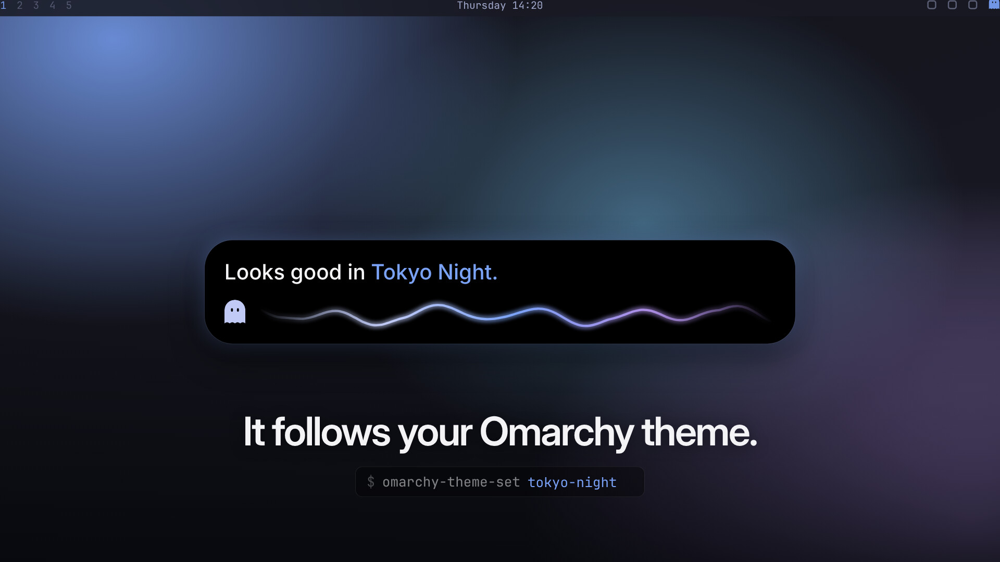
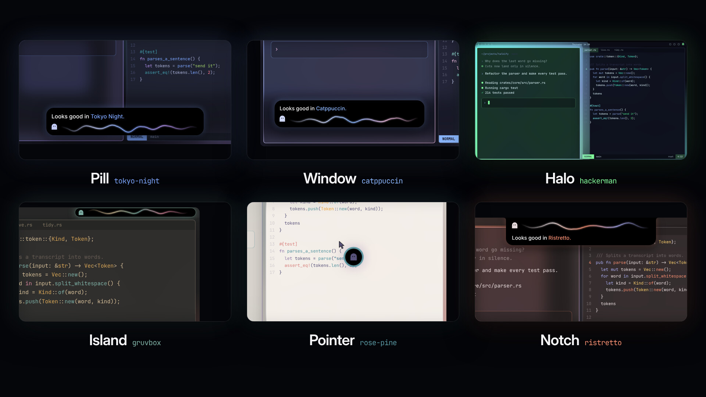
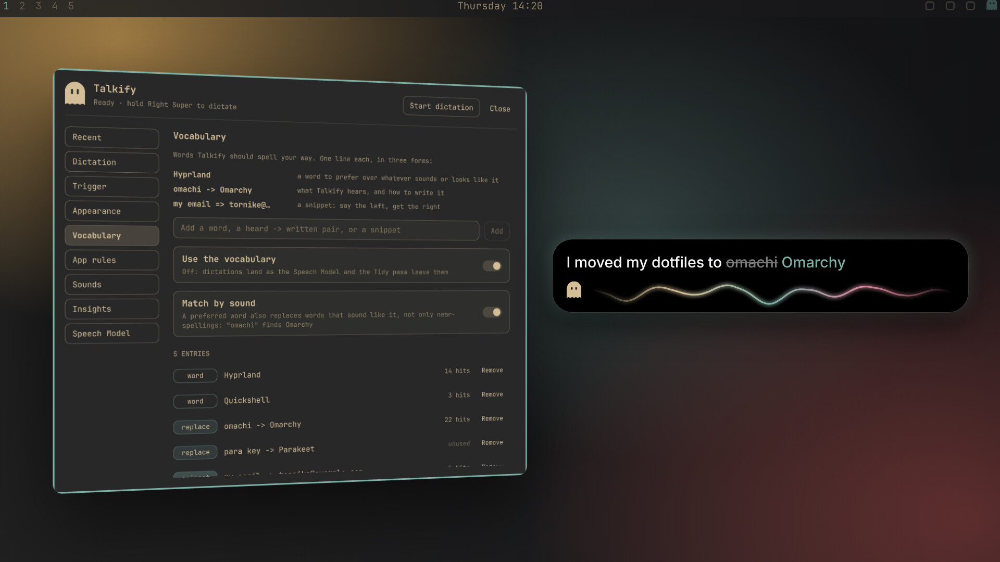
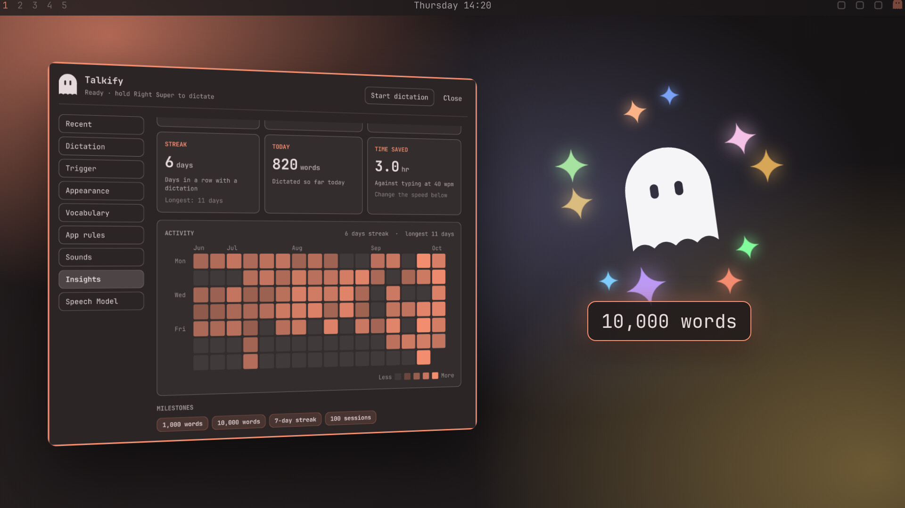
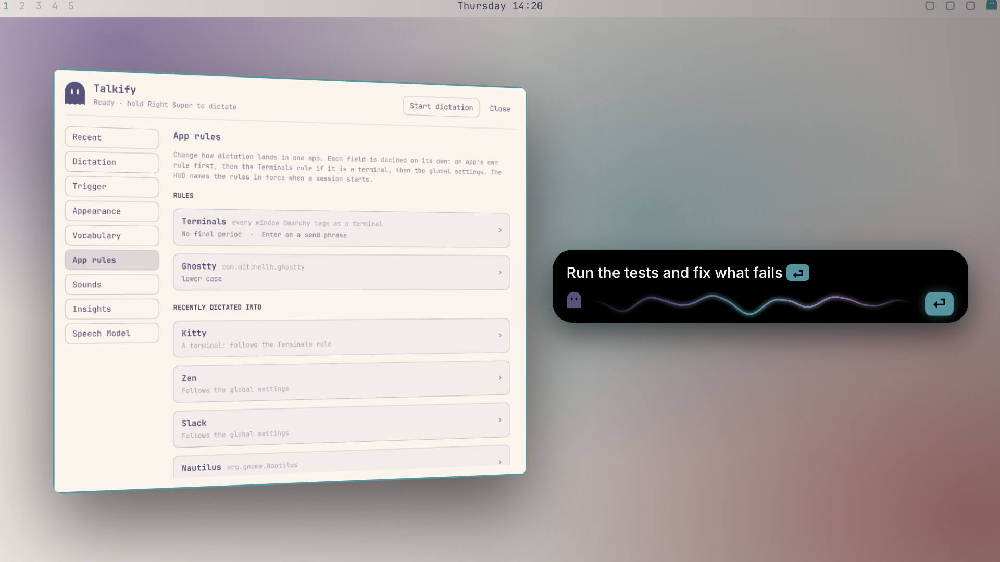

<h1 align="center">Talkify for Omarchy</h1>

<h3 align="center">Fast, beautiful and private voice dictation</h3>

<p align="center">
  
</p>

Hold Right Super, say what you want to write, and let go. The words land in the window you were typing in: a terminal, a browser, an editor, a chat.

Talkify started on the Mac, as [Talkify for macOS](https://github.com/tornikegomareli/Talkify) ([usetalkify.app](https://usetalkify.app)). This is the same idea rebuilt for [Omarchy](https://omarchy.org), with the same HUD and the same ghost, at home in the Omarchy bar and in whatever theme you run.

Speech is recognised on your machine by NVIDIA's [Parakeet TDT 0.6B v3](https://huggingface.co/nvidia/parakeet-tdt-0.6b-v3): about 0.3 seconds for an 11-second sentence on the CPU, in 25 European languages. No cloud, no account, nothing leaves your computer.

## Install

In one line:

```sh
curl -fsSL https://raw.githubusercontent.com/InsaneArts/talkify-omarchy/main/install.sh | bash
```

With Omarchy's package manager, from the AUR:

```sh
omarchy pkg aur add talkify-omarchy
talkify-setup
```

From source:

```sh
git clone https://github.com/InsaneArts/talkify-omarchy.git
cd talkify-omarchy
./install.sh
```

The one-line install and `install.sh` build Talkify from source into `~/.local`, installing Rust first if it is missing. The package installs it for the whole system, and `talkify-setup` puts it in your bar. Either way, the first start downloads the Speech Model (670 MB) while the ghost in the bar fills up.

Holding the key needs Talkify to read the keyboard, which means the `input` group:

```sh
sudo usermod -aG input "$USER"   # then log out and back in
```

Until then, tap the key instead of holding it, with this bind in `~/.config/hypr/bindings.lua`:

```lua
o.bind("SUPER + Super_R", "Dictation (Talkify)", "talkify tap", { release = true })
```

Talkify needs Omarchy 4 with Hyprland 0.56 or newer.

## Appearance

The HUD sits where you want it: a pill at the bottom, a caption on the window you are dictating into, a halo around it, an island in the bar, a mark by the pointer, or a notch from the top edge. It takes its colours from your Omarchy theme and changes the moment you switch.

<p align="center">
  
</p>

## Vocabulary

Teach Talkify the names and words you use. When it gets one wrong, fix it, select your fix and run `talkify teach`, and from then on it writes it your way. Words match by how they sound as well as how they are spelled, and a short phrase can expand into a whole snippet.

<p align="center">
  
</p>

## Insights

How much you dictate, how fast, and how much typing it saved, with a sixteen-week heatmap in your theme's colours. The ghost celebrates each milestone. Only daily totals are kept, never the text.

<p align="center">
  
</p>

## App rules

Each app can have its own rules: whether to tidy the text, end with a period, write in lower case, or press Enter. Terminals come with one already, so saying "send it" at the end submits your prompt to a coding agent.

<p align="center">
  
</p>

## Using it

- Hold Right Super to talk, let go to insert. Tap it for hands-free, tap again to finish. Escape cancels.
- Click the ghost in the bar for settings, right-click it to start or finish a session.
- `talkify paste-last` pastes your last dictation again, `talkify retry` decodes it again, and `talkify status` shows what Talkify is doing.

To update, run the install again: the one-line install, `git pull && ./install.sh`, or your AUR helper for the package.

To remove Talkify:

```sh
systemctl --user disable --now talkify.service
omarchy plugin remove tornikegomareli.talkify
rm -f ~/.local/bin/talkify ~/.config/systemd/user/talkify.service   # after install.sh
omarchy pkg drop talkify-omarchy                                     # after the package
rm -rf ~/.config/talkify ~/.local/share/talkify                      # settings, history, the model
```

## Development

```sh
cargo test                       # the pure rules in crates/talkify-core
python3 tests/e2e.py             # a second daemon, real speech, every feature
quickshell -p plugin/dev         # the HUD, playing scripted sessions
```

The domain language is in [CONTEXT.md](CONTEXT.md) and the daemon's protocol in [docs/protocol.md](docs/protocol.md). The pictures here and the product film are code too, in [video](video).

## License

[MIT License](LICENSE). The bundled sounds are listed in [sounds/LICENSE-SOUNDS.txt](sounds/LICENSE-SOUNDS.txt).
